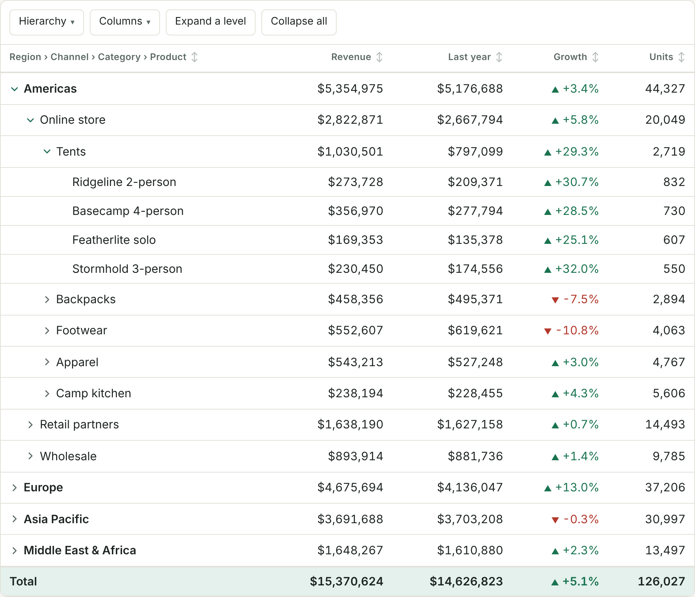

# Drill-down pivot table

A pivot table for data that nests deep. One recursive React component draws every level, each level is fetched only when you open it, and the hierarchy is plain configuration: reorder the levels and the same data regroups.

**[Live demo](https://davidhmoon.github.io/pivot-component-latest/)** · React 19 · TypeScript · 80 tests · invented data



## Why it is built this way

- **Rows are identified by their path, not their position.** `Europe/Wholesale` is a key. Open rows and loaded branches are stored by key, so sorting can never attach a branch to the wrong row.
- **Nothing loads until you open it, and reopening is free.** Opening a row asks for its children, filtered by its ancestors. Closing it keeps the branch, so reopening is instant and brings back whatever was open beneath it.
- **Expanding a level is one request.** The data source takes a batch, so "Expand a level" costs one round trip instead of one per row, and pressing it again never closes anything.
- **Each group sorts on its own.** A row never leaves its parent.
- **Totals are right.** Growth is worked out in the browser from the two sums it compares, so a total's growth comes from the totals. Averaging the rows' percentages gives a different, wrong number.
- **Failures stay local.** A failed request shows an error and a retry in that branch while the rest of the table keeps working. An answer that arrives after you have pivoted away is dropped.
- **The table knows nothing about the data.** It is given levels, columns and a data source with one method. The demo's source is an in-memory stand-in for a reporting API.

The table's state lives in one reducer ([`src/pivot/pivotState.ts`](src/pivot/pivotState.ts)), so every transition is tested without a browser. Component tests cover the behaviour above.

## Run it

```bash
npm install
npm run dev    # http://localhost:5173
npm test
```

## Where the design comes from

I first built this kind of table for a business-intelligence portal at a previous job, where sales data ran several levels deep and was far too large to load at once. My tech lead set the architecture; I designed the components and wrote the React. This repository rebuilds those ideas as a standalone component, with everything I would do differently now built in. The code is new, and the domain and numbers are invented.

## How it was built

Spec first, with Claude Code: the spec was the behaviour listed above, and the tests check it on every push before the demo deploys.
